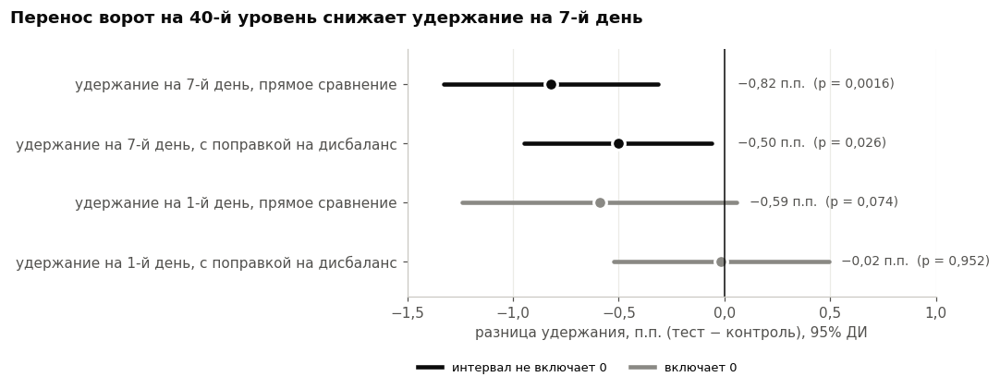
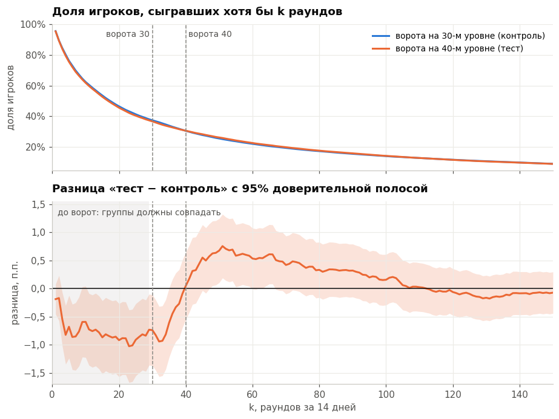
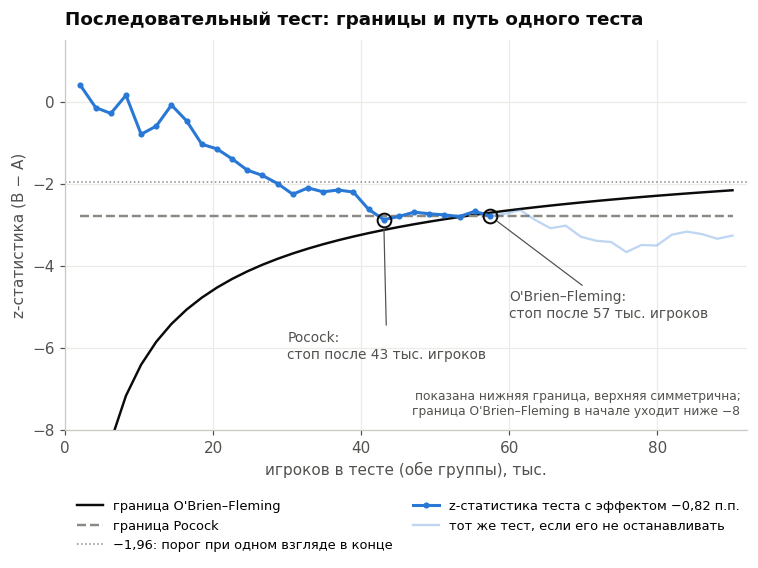

# A/B-тест Cookie Cats: переносить ли ворота с 30-го уровня на 40-й

[](https://github.com/Devo4kaRobot/ab-test-cookie-cats/actions/workflows/ci.yml)


Разбор A/B-теста мобильной игры Cookie Cats (90 189 игроков) от проверки качества эксперимента
до решения для продуктовой команды. *English summary is [below](#english-summary).*

**Решение: ворота оставить на 30-м уровне.** Перенос на 40-й снижает удержание на 7-й день:
на 0,82 п.п. в прямом сравнении групп (19,02% → 18,20%, p = 0,0016) и на 0,50 п.п. после поправки
на дисбаланс групп, найденный при проверке эксперимента (95% ДИ [−0,95; −0,06], p = 0,026).
Это примерно на 500–800 меньше вернувшихся через неделю игроков на каждые 100 000 установок.
Одностраничная записка для продакта — [reports/decision.md](reports/decision.md).



## Главное

1. **Эффект отрицательный и устойчивый.** Удержание на 7-й день в тесте ниже во всех вариантах
   анализа: z-тест, bootstrap, байесовская модель (P(тест хуже) = 99,9% в прямом сравнении), поправка
   на состав групп. Признаков пользы от переноса нет ни по одной метрике.
2. **Эксперимент проведён не идеально.** Группы разного размера: 44 700 против 45 489 при плане
   50/50 (SRM, p = 0,009). В тесте больше игроков, сыгравших меньше 29 раундов и ни разу не видевших
   ворот (+0,73 п.п., p = 0,023). Порог 29 выбран после просмотра данных, но перекос того же знака
   держится при порогах от 10 до 29 раундов.
3. **Дисбаланс завышает эффект примерно на 40%.** Величина min(раунды, 29) не зависит от положения
   ворот, поэтому по ней можно корректировать. С поправкой эффект на 7-й день −0,50 п.п. вместо
   −0,82, а разница в удержании на 1-й день (−0,59 п.п. в прямом сравнении) исчезает совсем
   (−0,02 п.п., p = 0,95). Тот же результат дают пост-стратификация и CUPED.

На графике ниже видно, как устроен дисбаланс. До ворот тестовая группа отстаёт. Между 40 и 100
раундами она обгоняет контроль: в контроле часть игроков застревает на воротах 30-го уровня.
Дальше разница исчезает.



## Результаты

| Метрика | gate_30 (контроль) | gate_40 (тест) | Прямое сравнение | С поправкой на дисбаланс |
|---|---|---|---|---|
| Удержание на 7-й день (цель) | 19,02% | 18,20% | **−0,82 п.п.** [−1,33; −0,31], p = 0,0016 | **−0,50 п.п.** [−0,95; −0,06], p = 0,026 |
| Удержание на 1-й день | 44,82% | 44,23% | −0,59 п.п. [−1,24; +0,06], p = 0,074 | −0,02 п.п. [−0,52; +0,49], p = 0,95 |
| Раунды за 14 дней, медиана | 17 | 16 | −1 [−1; 0], p = 0,0502 (Манна — Уитни) | — |

В скобках — 95% доверительные интервалы. Вторичная и барьерная метрики после поправки Холма
незначимы (p = 0,10).

## Проверки методики

| Что проверяли | Результат |
|---|---|
| Ложные срабатывания на 5000 A/A-тестах (α = 5%) | 4,3% (z-тест, точное значение 4,95%), 5,0% (Манна — Уитни) |
| Минимальный детектируемый эффект (MDE) при мощности 80% | 0,73 п.п. в прямом сравнении, 0,63 п.п. с поправкой |
| Подглядывание после каждой 1000 игроков (44 проверки) | ложные срабатывания 5,4% → 30,9% |
| Последовательный тест O'Brien–Fleming на тех же 44 проверках | ложные срабатывания 5,2%; мощность 86,7% против 88,4% у фиксированного дизайна; в среднем 69% выборки |
| CUPED с ковариатой min(раунды, 29) | ρ = 0,45, дисперсия ниже на 20%, оценка −0,48 п.п. [−0,94; −0,03] |



## Ограничения и что бы я сделал иначе

- Скорректированный эффект (−0,50 п.п.) ниже MDE этого теста, поэтому запаса по мощности нет и
  точная величина эффекта известна грубо: от −0,06 до −0,95 п.п.
- Поправка на дисбаланс выбрана после того, как дисбаланс нашёлся. Заранее объявленным остаётся
  прямое сравнение; скорректированная оценка — честнее по величине, но это анализ после факта.
- В данных нет дат, уровней и выручки. Поэтому встреча с воротами определяется косвенно (по числу
  раундов), а подглядывание и последовательные тесты разобраны на симуляциях.
- В следующем тесте стоит до запуска зафиксировать ковариаты для CUPED, логировать уровень и момент
  встречи с воротами и проверить механизм распределения по группам.

## Калькулятор размера выборки

[docs/index.html](docs/index.html) — страница без зависимостей: размер групп, длительность теста
и MDE для метрики-доли, с учётом CUPED. Формулы совпадают с `src/abtest/stats.py`.
Онлайн-версия: https://devo4karobot.github.io/ab-test-cookie-cats/

## Ноутбуки

| Ноутбук | Что внутри |
|---|---|
| [01 — дизайн и проверки](notebooks/01_design_and_checks.ipynb) | дизайн теста, SRM, проверка групп до воздействия, выбросы |
| [02 — анализ](notebooks/02_analysis.ipynb) | z-тест, bootstrap, байесовская оценка, раунды (Манна — Уитни, t-тест на логарифме, bootstrap медианы), поправка Холма, поправка на дисбаланс до ворот |
| [03 — симуляции](notebooks/03_simulations.ipynb) | A/A-тесты, MDE и мощность, подглядывание, последовательные тесты (O'Brien–Fleming, Pocock), CUPED |

Дизайн теста восстановлен по описанию датасета: записан так, будто тест ещё не начался, но
предрегистрации у эксперимента не было. Исходники ноутбуков лежат в `notebooks/src/*.py` (формат
percent, удобно смотреть изменения в git), собранные `.ipynb` — с выводами и графиками. Каждый
ноутбук запускается и в обычном Jupyter.

## Как запустить

Windows: двойной щелчок по `scripts\run_all.bat`. Скрипт создаст окружение, поставит пакеты,
скачает данные, прогонит тесты и пересоберёт ноутбуки (около двух минут).

Вручную:

```bash
python -m venv .venv && source .venv/bin/activate   # Windows: .venv\Scripts\activate
pip install -r requirements.txt
python scripts/get_data.py             # скачивает CSV и сверяет SHA-256
pytest -q
python scripts/build_notebooks.py      # пересобрать .ipynb с выводами
```

## Структура

```
├── src/abtest/
│   ├── stats.py          # SRM, z-тест, bootstrap, Манна — Уитни, Холм, MDE и мощность, CUPED, пост-стратификация
│   ├── bayes.py          # Beta-Binomial: P(B < A), интервалы, ожидаемые потери
│   └── sequential.py     # границы O'Brien–Fleming и Pocock, остановка теста
├── tests/                # проверки формул на известных значениях
├── notebooks/            # 01–03 .ipynb + исходники в notebooks/src
├── reports/
│   ├── decision.md       # решение на одну страницу
│   └── figures/          # графики из ноутбуков
├── docs/index.html       # калькулятор размера выборки
└── scripts/              # загрузка данных, сборка ноутбуков, run_all.bat
```

Статистика написана на numpy и scipy без statsmodels, чтобы формулы были на виду и покрыты тестами.

## Данные

Открытый датасет «Mobile Games A/B Testing — Cookie Cats» (Kaggle / DataCamp, игра Tactile
Entertainment): по каждому игроку — группа, число раундов за первые 14 дней и факт входа через 1 и
7 дней. Файл не хранится в репозитории: `scripts/get_data.py` скачивает его с публичного зеркала и
сверяет контрольную сумму.

## English summary

Analysis of the Cookie Cats mobile game A/B test (90,189 players): should the first progress gate
move from level 30 to level 40? **No.** Moving it lowers 7-day retention: −0.82 pp in the raw
comparison (19.02% → 18.20%, p = 0.0016) and −0.50 pp (95% CI [−0.95; −0.06], p = 0.026) after
adjusting for a pre-treatment imbalance. The experiment checks found a sample ratio mismatch
(p = 0.009) and more low-activity players in the test group among those who never reached any gate.
Since min(rounds, 29) cannot be affected by the gate position, post-stratification and CUPED on it
are valid; they shrink the 7-day effect by about 40% and remove the 1-day retention difference
entirely. Bootstrap and a Beta-Binomial model agree with the conclusion. The methods are validated
with 5,000 A/A tests, power analysis, a peeking simulation (false positives 5% → 31%) and
O'Brien–Fleming / Pocock sequential designs. Statistics are implemented in plain numpy/scipy with
unit tests; a sample-size calculator is in `docs/`. Notebooks and the decision memo are in Russian.

## Лицензия

Код — MIT. Данные принадлежат их авторам и используются в учебных целях.
